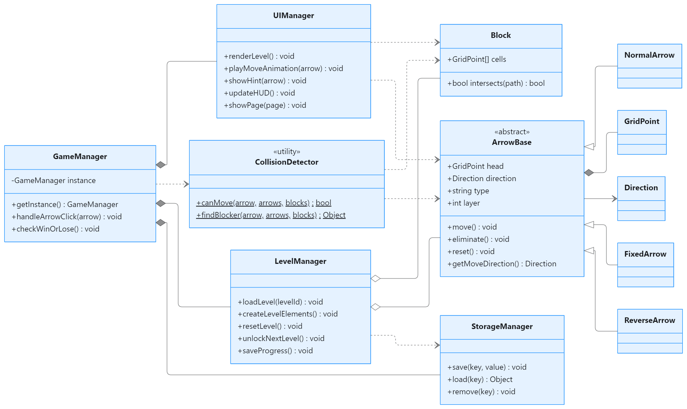
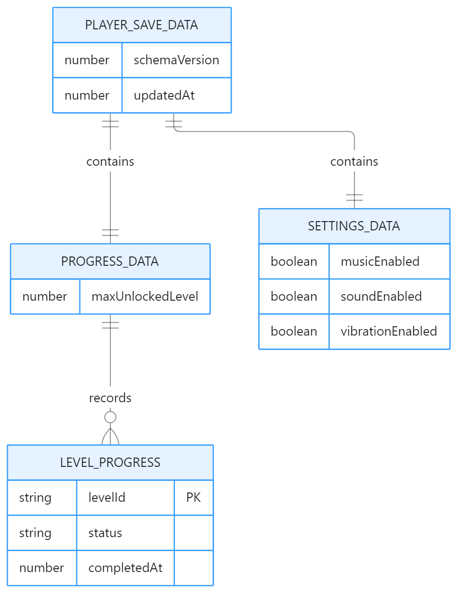

# 系统设计总说明书

## 1 设计概述

本说明书描述方向箭头解谜小游戏的总体架构、核心类设计和存储数据模型。项目面向 Cocos Creator 3.x 与微信小游戏平台，目标是在单机环境中完成固定关卡加载、箭头移动、阻挡判定、胜负结算、重置、提示和进度保存。

系统采用“游戏流程、关卡管理、领域对象、表现层、存储层”相互分工的结构。核心规则由模型和管理器负责，界面只负责输入、绘制和动画，避免场景节点直接决定游戏结果。

## 2 总体架构

| 层次 | 主要类型 | 职责 |
| --- | --- | --- |
| 应用层 | `GameManager` | 调度流程、维护生命与状态、处理胜负 |
| 关卡层 | `LevelManager` | 创建、重置和保存关卡，管理解锁进度 |
| 领域层 | `ArrowBase`、`NormalArrow`、`FixedArrow`、`ReverseArrow`、`Block` | 描述可交互对象及对象差异 |
| 服务层 | `CollisionDetector`、`StorageManager` | 提供路径检测和持久化服务 |
| 表现层 | `UIManager` | 绘制、点击、动画、提示和页面切换 |

`GameManager` 是全局协调者，并以单例形式提供访问入口。它持有 `LevelManager`、`UIManager` 和 `StorageManager`，通过静态工具 `CollisionDetector` 完成移动合法性判定。该结构能够满足课程项目中管理者、抽象类、继承、多态和工具类的设计展示要求。

## 3 功能模块

关卡模块负责加载创作者指定的固定关卡，生成箭头和墙体，并在重置时恢复初始状态。箭头模块保存位置、方向、类型和显示顺序，并通过子类处理普通、固定和反转行为。规则模块负责判断路径是否畅通、扣除生命、判断胜负以及生成提示。

界面模块将点击位置转换为游戏对象，显示棋盘和箭头，并播放滑出、退回及高亮动画。存储模块保存关卡进度和系统设置，不保存运行时节点或动画中间状态。

## 4 核心类设计

`ArrowBase` 是抽象基类，保存箭头头部、身体折线、移动方向、类型和显示顺序，并声明移动、消除、重置和获取实际移动方向的通用接口。三个子类通过重写实现行为差异：

- `NormalArrow` 按显示方向移动。
- `FixedArrow` 不可移动，作为固定障碍处理。
- `ReverseArrow` 沿显示方向的反方向移动。

`LevelManager` 持有当前关卡中的箭头和墙体，负责对象实例化与重置。`CollisionDetector` 接收箭头、箭头集合和墙体集合作为参数，不保存关卡状态。`GameManager` 根据检测结果协调动画、生命值和胜负判断。

| 类型 | 关键职责 |
| --- | --- |
| `GameManager` | 单例入口、流程调度、状态管理、胜负判定 |
| `LevelManager` | 关卡加载、元素创建、重置、解锁和进度 |
| `ArrowBase` | 公共属性、移动状态和统一行为接口 |
| `NormalArrow` | 普通直线移动 |
| `FixedArrow` | 固定不可移动 |
| `ReverseArrow` | 按显示方向的反方向移动 |
| `Block` | 保存墙体格子并参与阻挡检测 |
| `CollisionDetector` | 静态路径检测和阻挡物查询 |
| `UIManager` | 绘制、点击、动画、弹窗和 HUD |
| `StorageManager` | 读取、写入和删除本地存档 |

图 1 核心类与关系。图中的 `int`、`bool` 和 `Object` 为 UML 简写；使用 TypeScript 实现时分别映射为 `number`、`boolean` 和明确的数组或联合类型。

## 5 核心交互流程

玩家点击箭头后，`UIManager` 返回命中对象，`GameManager` 调用 `CollisionDetector.canMove()`。如果路径畅通，箭头进入移动状态，播放滑出动画；动画完成后由 `LevelManager` 移除对象，`GameManager` 更新剩余数量和界面。

如果路径受阻，`UIManager` 播放前进后退动画，逻辑坐标不变。若关卡规则判定本次操作失败，则由 `GameManager` 扣除生命并判断是否需要显示失败弹窗。

重置操作由 `GameManager` 调用 `LevelManager.resetLevel()`，根据初始关卡配置重新生成对象。提示操作扫描当前可移动箭头，仅高亮一个可立即释放对象，不改变关卡状态。

全部可清除箭头消失后，游戏进入通关状态，`LevelManager` 解锁下一关并通过 `StorageManager` 保存进度。当前版本暂将 `FixedArrow` 视为不可清除的固定障碍，不参与剩余可清除数量统计。

## 6 数据模型

存储采用一个固定键和一个存档根对象，根对象包含格式版本、更新时间、关卡进度和系统设置。关卡进度只记录已经解锁或完成的关卡；锁定状态由 `maxUnlockedLevel` 推导。

图 2 本地存储数据模型。

| 数据对象 | 字段 | 说明 |
| --- | --- | --- |
| `PLAYER_SAVE_DATA` | `schemaVersion`、`updatedAt` | 存档版本和最后更新时间 |
| `PROGRESS_DATA` | `maxUnlockedLevel` | 当前最高已解锁关卡 |
| `LEVEL_PROGRESS` | `levelId`、`status`、`completedAt` | 单关状态和完成时间 |
| `SETTINGS_DATA` | 音乐、音效、振动开关 | 系统设置 |

存档内容使用普通 JSON 对象和数组，不保存 `ArrowBase`、`Block`、Cocos `Node`、`Map` 或 `Set`。读取存档时先检查 `schemaVersion`，字段缺失时补充默认值。写入时生成完整根对象并一次性保存，减少不同字段不一致的情况。

### 6.1 存储原则

- 使用一个固定键保存完整存档根对象，避免多个键之间状态不一致。
- 通过 `schemaVersion` 识别旧格式，并在读取时补充缺失字段或执行迁移。
- 关卡箭头和墙体由 `LevelManager` 在进入关卡时重新创建，不写入本地存档。

## 7 非功能要求与验收

系统应在常见手机屏幕比例下保持棋盘居中和点击区域可辨认。单个关卡规模较小时，网格路径检测可以直接同步执行。动画期间应禁止同一箭头重复触发，并在动画结束后再更新关卡集合。

课程版本可按以下条件验收：

1. 普通、固定和反转箭头能够按各自规则表现。
2. 墙体和其他箭头能够阻止移动，受阻对象能够回到原位。
3. 全部可清除箭头消除后显示通关，生命耗尽后显示失败。
4. 重置能够恢复关卡初始状态，提示能够高亮可释放箭头。
5. 退出并重新进入游戏后，关卡进度和设置可以恢复。
